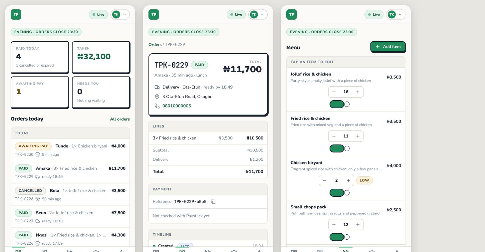

# Chat to paid order

**A Chord AI teammate on WhatsApp for a Nigerian food vendor.** A customer asks what is on the menu, orders, gets a Paystack link, pays, and the order is confirmed with stock reduced. The vendor watches it happen on an admin panel.

| | |
|---|---|
| **Try the agent** | https://chat.tsglabs.dev/c/161x1iBUglWnrJc3APYog6u- (WhatsApp simulator; pick "Success" on the Paystack test checkout) |
| **Admin panel** | https://chat-to-order-986.netlify.app · login `devferanmi@gmail.com` / `tplus-demo-2026` |
| **Backend + MCP server** | https://backend-production-c54f.up.railway.app |
| **Code** | https://github.com/spiderocious/chat-to-order |
| **Plan** | [Plan Document](https://chat-to-order-986.netlify.app/docs/plan.html) |
| **Backend + MCP technical design document** | [backend + MCP document](https://chat-to-order-986.netlify.app/docs/tech-spec-backend.html) |
| **Web application technical design document** | [web design doc](https://chat-to-order-986.netlify.app/docs/tech-spec-web.html) |
| **Recording** | 3-minute walkthrough in the Drive folder |


---


[](docs/screenshots/03-phone-board-detail-menu.jpg)

---

## Contents

1. [The problem and the business](#1-the-problem-and-the-business)
2. [What the agent does](#2-what-the-agent-does)
3. [How it is built](#3-how-it-is-built)
4. [Testing and results](#4-testing-and-results)
5. [Deployment field notes](#5-deployment-field-notes)
6. [Go-live note for the business owner](#6-go-live-note-for-the-business-owner)
7. [Links](#7-links)
8. [Run it yourself](#8-run-it-yourself)
9. [Repository layout](#9-repository-layout)

---

## 1. The problem and the business

### The vendor

[TPlus Kitchen](https://www.instagram.com/teeplus_events/) ([@Tplusevent](https://x.com/Tplusevent)) is a food and small-chops vendor in Osogbo, Osun State. Daily food delivery, daily small chops delivery, food trays and cocktails for events, and customers can only order on whatsapp. There is no website, no ordering app and no payment page. Every order is a conversation, and every payment is a bank transfer that somebody has to match to a chat.

TPlus is one of a very large crowd. The menu, prices, zones and portion counts in this demo are illustrative.

### The size of the crowd

- Nigeria has **39.65 million micro, small and medium enterprises**, and 96% of them are nano or micro businesses, most of them sole proprietors ([SMEDAN / NBS national survey](https://www.nigerianstat.gov.ng/pdfuploads/MSMES.pdf)). Informal businesses push the real number higher ([FATE Foundation](https://fatefoundation.org/wp-content/uploads/2024/03/7.-SMEDAN-1.pdf)).
- Roughly **14 million Nigerian small businesses sold through Meta's apps (Facebook, Instagram, WhatsApp) in 2025**, which a Meta-commissioned study values at about $820 million a year to the economy ([Vanguard, 2026](https://www.vanguardngr.com/2026/05/how-facebook-instagram-whatsapp-pump-820-m-into-nigerias-economy-yearly/)).
- WhatsApp reaches about **95% of Nigerian internet users** ([Yazi](https://www.askyazi.com/articles/whatsapp-penetration-across-africa-statistics-by-country)). In an analysis of 74,901 listed Nigerian businesses, only 57.7% had a website; business happens over calls and WhatsApp ([myhustle.space](https://myhustle.space/insights/state-of-small-business-nigeria-2026)).
- The money is already digital. Electronic payments in Nigeria reached **₦284.99 trillion in the first quarter of 2025**, up 17.7% on the year ([Nairametrics](https://nairametrics.com/2025/07/26/e-payment-transactions-in-nigeria-hit-n284-9-trillion-in-q1-2025/)), after about ₦1.07 quadrillion in 2024. Instant transfer is the default way a customer pays a small vendor.
- Online food delivery alone is a **$1.14 billion market in 2025**, forecast to reach $2.7 billion by 2034 ([IMARC](https://www.imarcgroup.com/nigeria-online-food-delivery-market)); the aggregators that make up that number take a cut of every order and own the customer relationship. The WhatsApp vendor is the part of the market the aggregators have not reached.

Nobody publishes a count of orders placed over WhatsApp; the figures above are the boundaries of the problem, not a measurement of it.

### Where the money leaks

- **Fake proof of payment.** A screenshot is not a payment. Doctored transfer alerts are a known pattern against small sellers ([The Guardian Nigeria](https://guardian.ng/news/concerns-as-more-nigerians-fall-prey-to-fake-bank-alerts/), [ThisDay](https://www.thisdaylive.com/2025/06/28/how-not-to-fall-prey-to-fake-bank-alerts/)). NIBSS counted **67,518 digital-payment fraud cases in 2025 with ₦25.85 billion lost**, down from ₦52.26 billion in 2024 ([Legit.ng](https://www.legit.ng/business-economy/money/1706685-nigeria-banks-face-fraud-trend-attacks-bigger-losses/)); mobile-money agents put their own 2024 losses at up to ₦42.6 billion, "mainly through fake alerts" ([Techpoint](https://techpoint.africa/insight/major-hack-and-fraud-cases-in-nigeria/)). Most vendor losses are never reported.
- **Oversold dishes.** The portion count lives in the cook's head. Two customers order the last pan of biryani in the same minute; one gets a refund argument.
- **Lost orders.** "I want" never becomes "I've paid", or a transfer lands with no name and nobody can match it to a chat.
- **Time.** A kitchen like this answers the same three questions, "what do you have", "how much with delivery", "I've sent it, check", perhaps 100 to 200 times a day, typed by the same person who is cooking (illustrative, not measured).

### Why the vendor would pay

If the assistant takes even half the repetitive messages and stops one oversold dish a day, that is an hour of the owner's time and one refund argument a day. A flat fee of a few thousand naira a month, or a small per-order fee, is cheap against that. The alternative, a delivery aggregator, takes a percentage of every order and puts the kitchen under someone else's brand; this keeps TPlus on the WhatsApp number its customers already have.

### What the agent solves

It shows today's menu with live portion counts, takes the order, prices it with the delivery fee, sends a Paystack link, confirms the order only when Paystack says the money arrived, reduces the portions, and gives the owner a board to watch from the kitchen. It never confirms an order that was not paid, and nobody at TPlus answers "how much is jollof" again.

### Deliberately left out

Delivery dispatch and rider tracking, refunds, event catering and food trays (TPlus's other business line; the assistant hands those to the owner), multiple vendors, building the menu from photos, customer accounts, Pidgin or Yoruba beyond a light touch, and gadget-vendor needs (serial numbers, warranties, pay on delivery). Gadget vendors are the stated next vertical: same engine, more trust and stock rules.

---

## 2. What the agent does

One teammate on Chord, one skill, four tools over MCP. The conversation, as it ran in the simulator on 27 October after the vendor switch (screenshots linked):

| Customer | Teammate | |
|---|---|---|
| "Good evening, what do you have tonight?" | Calls `get_menu`. Lists the eight items with prices and "only 2 left" where it matters, the three delivery zones with fees, and free pickup in Oke-Fia. | [05](docs/screenshots/05-simulator-menu.jpg) |
| "2 jollof and 1 chapman, deliver to 12 Gbongan Road, Oke-Fia. My name is Tobi." | Calls `create_order`. Replies with the lines, delivery ₦500, total ₦8,500, the Paystack link, its expiry, and "Order TPK-0231 · ref TPK-0231-5efc". | [06](docs/screenshots/06-simulator-order-link.jpg) |
| "paid" (before actually paying) | Calls `verify_payment`. "I haven't seen your payment yet, so I'm not treating the order as paid." Never the word "failed". (This reply also carried a stray apology; field note 5.10.) | [07](docs/screenshots/07-simulator-paid-before-paying.jpg) |
| Pays on Paystack's test checkout (NGN 8,730.97 with the customer-borne fee) | Lands on a "Payment received, reply paid on WhatsApp" page showing TPK-0231. | [02](docs/screenshots/02-paid-page-live.jpg) |
| "paid now" | Calls `verify_payment` then `confirm_order`. "Payment received, Tobi. Your order is confirmed. Order TPK-0231 … ready by about 7:15pm, and the rider will call you." | [08](docs/screenshots/08-simulator-confirmed.jpg) |
| "Also add 5 biryani for pickup, same name" | `create_order` refuses with `item_unavailable, max_qty: 2`. "We only have 2 chicken biryani left tonight, so I can't do 5. 2 at ₦4,000 each, or a swap." | [09](docs/screenshots/09-simulator-stock-guard.jpg) |

On the panel the same order is [TPK-0231](docs/screenshots/10-order-detail-live.jpg): timeline created → link issued → confirmed (by the reconciler, 18:32) → verified (by the model, 18:32), two successful Paystack checks, four tool calls. The [activity screen](docs/screenshots/11-activity-live.jpg) lists every call with its latency.

### The four tools

| Tool | What it does | External call |
|---|---|---|
| `get_menu` | Current window, whether orders are open, every offered item with price and portions left, delivery zones, pickup address | none |
| `create_order` | Validates items and quantities against stock and the cut-off, prices the cart in kobo, writes a pending order, creates the Paystack transaction, returns the link. Idempotent for the same cart | Paystack `transaction/initialize` |
| `verify_payment` | Asks Paystack about a reference; maps the answer to `success`, `not_confirmed`, `failed` or `amount_mismatch` | Paystack `transaction/verify` |
| `confirm_order` | Verifies again, locks the order and the menu rows, decrements portions, marks paid with a ready-by time. Idempotent on the reference. A sold-out line after payment becomes `paid_needs_attention` for the vendor | Paystack `transaction/verify` |

### Rules the code enforces regardless of what the model does

- Money is integer kobo everywhere. Every money field is returned twice, as `*_kobo` and as a display string the model repeats.
- An order is confirmed only when Paystack's verify says success and the requested amount and currency match.
- Stock moves once per reference, inside a transaction with row locks. Two customers paying for the last portion at the same instant: one is confirmed, the other is flagged for the vendor.
- "Pending" and "abandoned" are "not confirmed yet", never "failed".
- The model cannot set a price, a status or a count. Its arguments are validated and normalised (item by id or name, zone by id or name in any spelling); its errors are full sentences with a `next_step`.
- A reconciler re-verifies pending orders every minute, so a customer who pays and never says "paid" is still confirmed.

---

## 3. How it is built

```
WhatsApp simulator ──► Chord teammate (skill: food-vendor, rev 7)
                             │  MCP over Streamable HTTP, bearer auth
                             ▼
                     Go + Gin service on Railway ──► Paystack (test mode)
                     ├── Postgres: orders, stock, audit, tool calls
                     ├── Redis: cache, locks, rate limits, idempotency, pub/sub
                     └── REST + SSE ──► React admin panel on Netlify
```

| Part | Stack | Notes |
|---|---|---|
| Backend + MCP | Go 1.27, Gin, pgx, goose, go-redis, MCP Go SDK | One service: `/mcp` for Chord, `/api/v1` for the panel, `/paid` for the customer, `/healthz`, `/metrics` |
| Database | Postgres on Railway | Schema, the vendor and the menu seeded by migrations (0005 switched the vendor to TPlus without touching existing orders); `version` columns for optimistic concurrency |
| Redis | Railway | Every use fails open; correctness lives in Postgres |
| Admin panel | React 19, TypeScript, Vite, TanStack Router + Query, Tailwind v4, motion | Light mode, mobile-first, live updates over SSE, polling when degraded. Screens: [board](docs/screenshots/01-board-desktop-live.jpg), [order](docs/screenshots/10-order-detail-live.jpg), [menu](docs/screenshots/04-menu-desktop-live.jpg), [settings](docs/screenshots/12-settings-live.jpg), [activity](docs/screenshots/11-activity-live.jpg), [phone](docs/screenshots/03-phone-board-detail-menu.jpg) |
| Skill | `SKILL.md` + two references | Revision 7, after seven rounds of real-conversation fixes |
| Hosting | Railway (backend, from `/backend`), Netlify (panel, from `/frontend`) | Two deployables, same repo, nothing at the root |

No Paystack webhook: the account is shared with other projects, so payment truth comes from calling verify, and the reconciler covers the silent-payer case. The admin login is bootstrapped at boot from `ADMIN_EMAIL` / `ADMIN_PASSWORD` (keyed on email, rotated when the env value changes, sessions revoked on rotation); there is no endpoint that can mint or reset an admin.

Full designs: [backend + MCP](https://chat-to-order-986.netlify.app/docs/tech-spec-backend.html), [admin panel](https://chat-to-order-986.netlify.app/docs/tech-spec-web.html), and the [build plan](https://chat-to-order-986.netlify.app/docs/plan.html) (sources in [docs/](docs/)).

---

## 4. Testing and results

Tested at every layer before the next was built on it, then again on the hosts, then once more after the vendor switch.

| Layer | What ran | Result |
|---|---|---|
| Backend unit + integration | `go test -race`: money, windows, Paystack mapping, alias decoding, zone-by-name; real-Postgres tests for create/verify/confirm, idempotent cart, validation matrix, mismatch and declined, Paystack down, admin transitions, six goroutines racing for the last two portions | green |
| End-to-end smoke, local | 52 checks through `/mcp` and `/api/v1` with the fake checkout | 52 / 52 |
| End-to-end smoke, live on Railway | Same with the real Paystack test key | 46 / 46 |
| Chord registration | Tools discovered (4), health probe `ok` | ok |
| Real conversations | 7 turns by API and 12 turns in the simulator across the day, three real Paystack test payments, all confirmed | confirmed |
| Admin panel | Signed in on the live site; every screen at desktop and 390 px; CORS verified | ok |
| Credits | 27 teammate requests in total, including the recording | 2.93 of 50 used |

Tool latency on the live service for TPK-0231: `get_menu` 4 to 13 ms, `create_order` 1,329 ms (one Paystack initialize) then 5 ms for the idempotent repeat, `verify_payment` 336 ms, `confirm_order` 11 ms.

---

## 5. Deployment field notes

Ten problems hit while building and deploying, in the order they happened. Each: what happened, how the cause was found, the fix, and what Chord, Paystack or Railway could change.

### 5.1 Chord's model guessed the tool argument names, and the customer saw the retries

**What happened.** First real order. The teammate called `create_order` three times and every call failed schema validation: `missing properties: ["customer_name" "items" "fulfilment"]`, then `unexpected additional properties ["id"]`, then `["quantity"]`. It gave up and sent its own narration to the customer: *"Trying the quantity field under a different name."*

**How I found the cause.** The `steps` array on `POST /v1/external-chat/messages` lists every tool call with its result text, so all three attempts were visible in one response. The MCP Go SDK infers a schema with `additionalProperties: false`, so `id` for `item_id` and `quantity` for `qty` were hard rejections, with validator text as the error.

**Fix.** The server publishes an explicit, lenient schema (an example in the description, no `additionalProperties: false`, no hard `required` list) and the handler normalises aliases (`id`/`item`/`name` → `item_id`, `quantity`/`count` → `qty`, `customer`/`name` → `customer_name`, `fulfillment` → `fulfilment`, a bare order number where a reference is expected). Validation errors became full sentences with a `next_step`. The skill gained: never narrate tool attempts to the customer. The next conversation succeeded on the second call and the customer saw a clean reply.

**What I'd change in Chord.** Surface the tool's `inputSchema` example to the model more prominently, or let a server mark a tool lenient so near-miss arguments pass through. And treat a reply containing tool-retry narration as a failed turn rather than delivering it.

### 5.2 Paystack passes its fee to the customer, so the verified amount is not the order total

**What happened.** The order total was ₦8,700. Checkout showed **NGN 8,934.02**. `verify_payment` returned `amount_mismatch`, the guard refused to confirm, and the customer was told the vendor would be in touch.

**How I found the cause.** The checkout page itself showed the larger figure. Paystack's verify response carries `amount` (what was charged, fee included when the merchant passes it to the customer), `requested_amount` (what we asked for) and `fees`. The code compared `amount`.

**Fix.** Compare the order total against `requested_amount`, falling back to `amount`, and record both plus `fees` on the payment check. A unit test pins the fee-bearer case. The same order confirmed on the next "paid". (TPK-0231 today: ₦8,500 requested, NGN 8,730.97 charged, confirmed.)

**What I'd change.** Paystack: put `requested_amount` next to `amount` in the verify docs with one sentence on fee bearer. Chord: the built-in Paystack connector should say which figure it checks.

### 5.3 Paystack rejects a `.example` payer email

**What happened.** Live `create_order` failed with `paystack_rejected: "email" must be a valid email.` The server sent `orders+ibk-0231@iyabisi.example` because WhatsApp customers give no email and `.example` is the reserved documentation TLD.

**How I found the cause.** The tool returned Paystack's message verbatim and the Railway log had the same text. Local runs use a fake Paystack, so the first real initialize was on the deployed service.

**Fix.** A configurable `ORDER_EMAIL_DOMAIN` with a valid default; the per-order address stays synthetic and nothing is emailed.

**What I'd change.** Paystack: accept RFC 2606 reserved domains in test mode, or say in the docs that the TLD is validated. For me: one real initialize before trusting the fake.

### 5.4 The Skills API refuses a new skill until the teammate is "migrated"

**What happened.** `POST /v1/teammates/{id}/skills` on a teammate created seconds earlier returned `400 FAILED_PRECONDITION: Initialize skills from existing instructions before modifying them`.

**How I found the cause.** The skills guide mentions `skills/migrate` for legacy teammates; a brand-new teammate created with a `persona` is also "legacy" in this sense. Migrate turned the persona into an "Existing instructions" skill and unlocked the endpoint.

**Fix.** Create → migrate → create skill → publish → exclude the placeholder skill. Scripted in `backend/scripts/chord/00-create-teammate.sh`.

**What I'd change in Chord.** Auto-migrate on first skill create, or accept skill files on `POST /v1/teammates`. Also, two skills responses contain raw control characters inside JSON strings, which strict parsers reject, and `GET /skills/{id}` returned 500 all afternoon while the list endpoint worked.

### 5.5 Railway: the GitHub app had no access to the new repo, and `railway up` from a subfolder breaks the root directory

**What happened.** The first deployment built from the repo root and failed (no Dockerfile there). After setting `rootDirectory: backend` through the GraphQL API, `railway up` from inside `backend/` uploaded that folder as the snapshot root, so the builder looked for `backend/backend`. A push to `main` triggered nothing: `railway service source connect` answered `User does not have access to the repo`.

**How I found the cause.** `railway logs --build` per deployment id, and a GraphQL `serviceInstance` query to confirm `rootDirectory` and `source.repo`.

**Fix.** `railway up` from the repository root with the root directory set to `backend`. Auto-deploy on push needs the Railway GitHub app granted on the repo, a browser-only step for the account owner.

**What I'd change.** Railway CLI: a `--root-directory` flag, and a clear message when `up` runs from a subfolder of a service with a root directory.

### 5.6 The demo depended on the time of day

**What happened.** The live smoke failed 13 checks at 16:05 WAT because the headline dish was seeded lunch-only and the lunch window had closed. A reviewer trying the agent in the evening would have been told jollof is not available.

**How I found the cause.** `get_menu` on the live service listed only evening items; the smoke asserted on jollof.

**Fix.** A migration makes the mains all-day; asun stays evening-only so the window rule is still demonstrable. The smoke uses unique customer names per run so it never collides with an older open order.

**What I'd change.** Nothing on Chord's side. For me: seed demo data for the reviewer's clock, not the builder's.

### 5.7 The model used the example reference from the skill as if it were real

**What happened.** Asked to "check again", the teammate called `verify_payment` with the placeholder reference from the skill's examples and the tool description, not the real one. On `unknown_reference` it told the customer it had never created the order and that the link "didn't come from the kitchen's system", which was false.

**How I found the cause.** The `steps` for that turn show the exact argument. The reply that carried the link had omitted the reference, and tool results are not part of the conversation history on later turns, so the only reference-shaped strings the model could see were the examples.

**Fix.** Every reply that sends a link must carry the order number and reference on their own line. All examples use obvious placeholders (`TPK-0000-xxxx`) and say so. Hard rules: a reference only comes from `create_order` in this conversation or from the order number the customer reads on the payment page (the tools accept the order number alone); never retract or deny an order unless a tool proves it. `unknown_reference` now says exactly what to ask the customer. On the next turn the teammate verified by order number and confirmed correctly.

**What I'd change in Chord.** Keep tool results, or at least their `next_step` and ids, in the context of later turns, or give tools a small per-conversation memory. Today a builder has to smuggle state through the model's own replies.

### 5.8 The reconciler confirmed the order before the model did

**What happened.** After the fee fix deployed, the next "paid" led to `confirm_order` returning `already_confirmed: true, confirmed_by: reconciler`. The same happened in every simulator run since, including TPK-0231 today. The background reconciler had re-verified the pending order on its one-minute tick and confirmed it first.

**Why it matters.** This is the no-webhook design working: a shared Paystack account cannot point a webhook at this service, so payment truth comes only from verify, and the reconciler covers customers who pay and never say so. The model path and the reconciler path converged on the same row under the row lock, with one stock decrement.

**What I'd change.** Nothing; this is the behaviour I wanted. The go-live note explains the lag of up to about three minutes.

### 5.9 Models send zone names, not zone ids

**What happened.** Switching the demo vendor to TPlus brought zones like `okefia` with the display name "Oke-Fia". The alias test that feeds the decoder what a model actually sends, `"zone":"Oke-Fia"`, failed: lower-casing gave `oke-fia`, which matched no zone id, so a real customer saying "deliver to Oke-Fia" would have been told the zone was unknown.

**How I found the cause.** The decoder test failed on the first run after the rename; items already matched by name, zones did not.

**Fix.** Zones match on letters and digits only, by id or by display name, so "Oke-Fia", "oke fia" and "okefia" are the same zone, and the canonical id is written to the order. A test pins all three spellings.

**What I'd change.** For me: never expose an id to a model that a human would spell differently; accept the human spelling everywhere.

### 5.10 A fresh conversation apologised for a correction it never made

**What happened.** On a brand-new simulator link, the first "paid" reply opened with *"The order does exist in the system … I was wrong to tell you not to rely on it, so please ignore that correction."* Nothing of the kind had been said in that chat. The rest of the reply was right (not confirmed yet, link still open).

**How I found the cause.** The skill's hard rule from 5.7 ("never tell the customer an earlier message was wrong … unless a tool proves it") was being read as an instruction to issue a retraction, and the same customer name had been used in an earlier test conversation where a retraction had actually happened.

**Fix.** Skill revision 7: every conversation starts fresh; never mention, correct or apologise for anything the customer cannot see in this chat. The confirmation and stock-guard turns that followed were clean.

**What I'd change in Chord.** Make it explicit in the teammate docs whether any memory crosses conversations for the same contact, and let a builder turn it off per teammate. Also: once a teammate is in skills mode its `persona` is frozen, and `PUT /v1/teammates/{id}/playbook` says so cleanly (`409 SKILLS_ENABLED: "This teammate uses skill files. Save a skill draft and publish it"`), but `PUT /v1/teammates/{id}` with any non-empty `persona` returns `500 INTERNAL` instead of that 409 (empty or null is a 200 no-op; `display_name`, `first_name`, `role` and `avatar` all apply). The stale persona is inert, since the system prompt comes from the published skill, but the generic update endpoint is missing the guard the playbook endpoint has.

---

---

## 6. Go-live note for the business owner

**What it does.** Customers message your WhatsApp number. The assistant shows today's menu from your admin panel, takes the order, sends a Paystack payment link, and confirms the order only after Paystack says the money arrived. Your portion counts go down by themselves. You watch orders arrive on the board, on your phone or laptop.

**What it does not do.** It does not send riders, give refunds, handle complaints about food already delivered, take event or tray bookings, or add dishes by itself. You set the menu, prices and portions each morning in the panel. If a dish runs out after someone has paid, the order turns red as "Needs you" and you call the customer to swap it or refund by transfer yourself.

**Before real customers use it.**
1. Your own Paystack business account with live keys and your settlement bank account. Today it runs on test keys; test cards work, real cards do not.
2. Your WhatsApp Business number connected to Chord. Today it runs in Chord's simulator.
3. Real prices, portions, zones and the pickup address in the panel, and the service windows set to your real hours.
4. A Chord credit top-up and somebody watching the balance. When credits run out the assistant goes silent.
5. A one-week trial with five regulars you trust, with you watching the board.

**When a payment fails.** The customer sees the bank's reason and gets a fresh link. Nothing is recorded and no food is reserved. If a customer closes the payment page without finishing, the link stays open for 30 minutes, then the order expires on its own.

**When something breaks.** If Paystack or the ordering system is down, the assistant tells the customer nothing was charged and to try again in a minute, and the Activity page shows the error. If the assistant cannot answer at all, customers get no reply; call Feranmi. Alerts to your phone when an order needs you or the service is down are the first thing to add after launch.

**Next.** Adding dishes by sending a photo of your handwritten menu, a WhatsApp alert when an order needs you, and event-tray enquiries routed to you with the details already collected. Gadget sellers are the next vertical: same assistant, plus stock counts, warranties and pay-on-delivery.

---

## 7. Links

**Live**
- WhatsApp simulator chat with the teammate: https://chat.tsglabs.dev/c/161x1iBUglWnrJc3APYog6u-
- Admin panel: https://chat-to-order-986.netlify.app (login `devferanmi@gmail.com` / `tplus-demo-2026`)
- Backend health: https://backend-production-c54f.up.railway.app/healthz
- MCP endpoint (bearer-protected): https://backend-production-c54f.up.railway.app/mcp

**Plan and designs (hosted)**
- Build plan: https://chat-to-order-986.netlify.app/docs/plan.html
- Backend and MCP technical design: https://chat-to-order-986.netlify.app/docs/tech-spec-backend.html
- Admin panel technical design: https://chat-to-order-986.netlify.app/docs/tech-spec-web.html

**Code and documents**
- Repository: https://github.com/spiderocious/chat-to-order
- Design sources: [docs/plan.html](docs/plan.html), [docs/tech-spec-backend.html](docs/tech-spec-backend.html), [docs/tech-spec-web.html](docs/tech-spec-web.html)
- Screenshots: [docs/screenshots/](docs/screenshots/)
- The skill: [backend/skill/food-vendor/](backend/skill/food-vendor/)

**The business**
- TPlus Kitchen on Instagram: https://www.instagram.com/teeplus_events/
- TPlus on X: https://x.com/Tplusevent

**Reference**
- Chord API docs: https://api.chordhq.xyz/docs
- Paystack transaction API: https://paystack.com/docs/api/transaction/
- Paystack test payments: https://paystack.com/docs/payments/test-payments/

---

## 8. Run it yourself

### Backend

```bash
cd backend
cp .env.example .env            # PAYSTACK_FAKE=1 by default; no Paystack account needed locally
docker compose up -d            # Postgres on 5433, Redis on 6380
make dev                        # migrates, seeds the menu and six demo orders, listens on :8080
make test                       # go vet + go test -race (needs docker compose up)
make smoke                      # 52 end-to-end checks through /mcp and /api/v1
make skill                      # zip the Chord skill package
```

Local admin login: `devferanmi@gmail.com` / `admin12345` (from `.env.example`).

### Admin panel

```bash
cd frontend
cp .env.example .env            # VITE_API_BASE_URL=http://localhost:8080
pnpm install && pnpm dev        # http://localhost:5173
pnpm check                      # typecheck, lint, tests
```

### Deploy

- Backend: Railway service with root directory `backend`, Dockerfile build, Postgres and Redis attached, variables as in `backend/.env.example` plus `DATABASE_URL=${{Postgres.DATABASE_URL}}` and `REDIS_URL=${{Redis.REDIS_URL}}`. `railway up` from the repo root, or a push to `main` once the Railway GitHub app has the repo.
- Panel: Netlify site with base `frontend`, `netlify.toml` in that folder, `VITE_API_BASE_URL` set to the Railway domain. The build copies `docs/*.html` into the site under `/docs/`.
- Chord: `backend/scripts/chord/00-create-teammate.sh` then `01-register.sh`, with `CHORD_API_KEY`, `CHORD_WORKSPACE_ID`, `MCP_URL` and `MCP_BEARER_TOKEN` in the environment.

---

## 9. Repository layout

```
README.md                         this document
backend/                          Go service: cmd/server, internal/{config,money,clock,store,redisx,paystack,ordering,reconcile,activity,mcpserver,httpapi}
backend/skill/food-vendor/        SKILL.md + references/vendor-rules.md + references/conversation-examples.md
backend/scripts/                  smoke.sh, chord/00-create-teammate.sh, chord/01-register.sh, chord/02-usage.sh, chord/03-chat.sh
frontend/                         Vite app: src/routes, src/features/{auth,live,board,orders,menu,settings,activity}, src/shared/{api,ui,utils}
docs/                             plan.html, tech-spec-backend.html, tech-spec-web.html, screenshots/
```

---